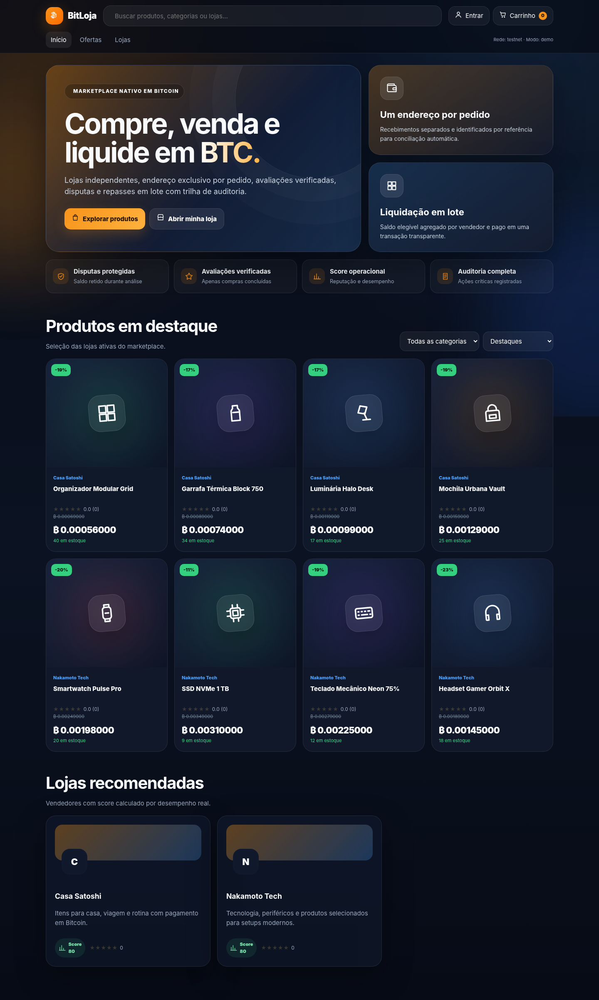
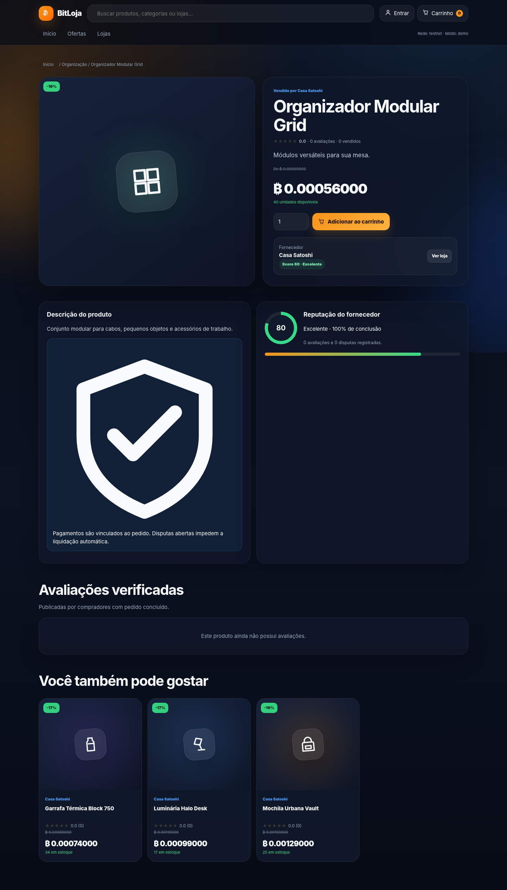
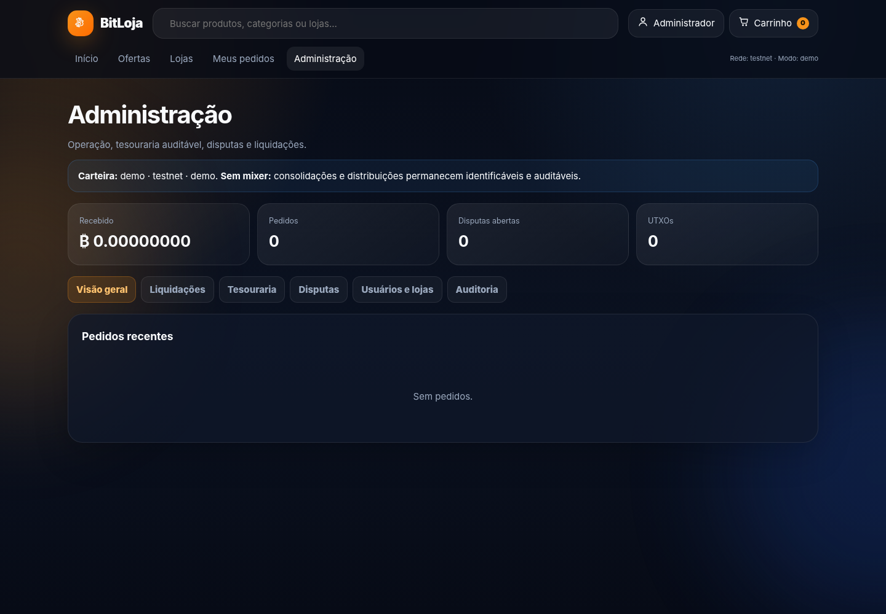
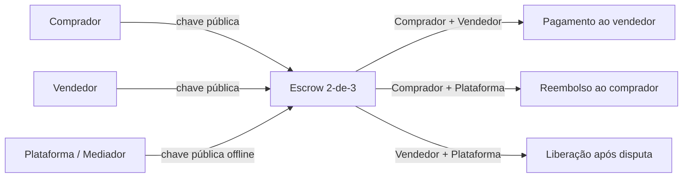
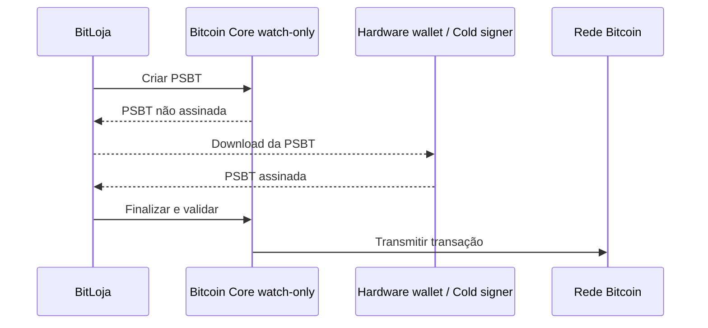
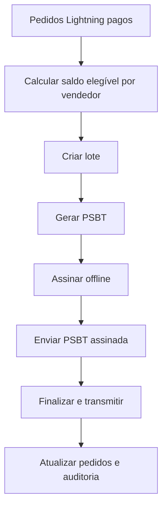

<div align="center">

# ₿ BITLOJA

### Marketplace completo com Bitcoin, escrow multisig 2-de-3, Lightning Network e PSBT

<p>
  <strong>Compre, venda, dispute e liquide pagamentos em Bitcoin com uma arquitetura pensada para reduzir custódia e exposição de chaves privadas.</strong>
</p>

<p>
  
  
  
  
  
</p>

<p>
  <a href="#-visão-geral">Visão geral</a> •
  <a href="#-recursos">Recursos</a> •
  <a href="#-como-executar">Instalação</a> •
  <a href="#-arquitetura-financeira">Arquitetura</a> •
  <a href="#-segurança">Segurança</a> •
  <a href="#-roadmap">Roadmap</a>
</p>

</div>

---

## ✨ Visão geral

A **BitLoja** é um marketplace inspirado em grandes plataformas de e-commerce, porém com pagamentos nativos em Bitcoin.

O projeto reúne catálogo, lojas independentes, carrinho, avaliações, reputação, disputas, mediação, escrow on-chain, Lightning Network e liquidação por PSBT em uma aplicação Flask simples de executar e estudar.

A arquitetura financeira separa claramente:

- **valor da venda**, protegido por escrow multisig 2-de-3;
- **comissão da plataforma**, controlada em carteira própria;
- **pagamentos Lightning**, tratados como fluxo rápido e custodial no nó da plataforma;
- **lotes de pagamento**, preparados como PSBT para assinatura offline.

> [!IMPORTANT]
> Este repositório é um **protótipo técnico**. Não utilize Bitcoin real antes de realizar auditoria independente, testes em regtest/testnet, revisão jurídica, hardening do servidor, backups e implantação segura das carteiras.

---

## 🖼️ Interface

### Página inicial



### Página de produto



### Painel administrativo



O frontend utiliza:

- bento grid;
- glassmorphism e blur;
- cartões com bordas arredondadas;
- banners responsivos;
- ícones SVG;
- navegação SPA em JavaScript puro;
- layout adaptado para desktop e dispositivos móveis.

---

## 🚀 Recursos

<table>
<tr>
<td width="50%" valign="top">

### 🛍️ Marketplace

- cadastro de compradores e vendedores;
- criação de lojas próprias;
- catálogo com categorias e busca;
- página completa de produto;
- carrinho dividido por loja;
- controle de estoque;
- histórico de pedidos;
- avaliações verificadas;
- produtos relacionados;
- painel do comprador;
- painel do vendedor;
- painel administrativo.

</td>
<td width="50%" valign="top">

### 🧾 Operação comercial

- score operacional de fornecedores;
- reputação baseada em entregas e avaliações;
- sistema de disputas;
- mensagens entre comprador, vendedor e admin;
- retenção de pedidos em disputa;
- mediação administrativa;
- reembolso;
- cálculo de comissão;
- lotes de pagamento para vendedores;
- logs de auditoria.

</td>
</tr>
<tr>
<td width="50%" valign="top">

### ₿ Bitcoin on-chain

- endereço de escrow exclusivo por pedido;
- multisig P2WSH 2-de-3;
- comprador, vendedor e mediador;
- carteiras watch-only;
- descriptors;
- consulta de UTXOs;
- sincronização de confirmações;
- criação, combinação e transmissão de PSBT;
- separação entre pagamento e comissão.

</td>
<td width="50%" valign="top">

### ⚡ Lightning Network

- modo de demonstração;
- integração com LND REST;
- integração com Core Lightning REST;
- geração de invoices;
- consulta de pagamento;
- webhook autenticado;
- poller opcional de recuperação;
- atualização automática do pedido;
- posterior liquidação dos vendedores por PSBT.

</td>
</tr>
</table>

---

## 🔐 Arquitetura financeira

### Escrow multisig 2-de-3

Cada pedido on-chain utiliza três chaves públicas:

| Participante | Papel |
|---|---|
| Comprador | Pode aprovar a liberação ou o reembolso |
| Vendedor | Pode aprovar o recebimento |
| Plataforma | Atua como mediadora em disputas |

São necessárias **duas das três assinaturas** para movimentar o valor do escrow.



A plataforma não possui uma assinatura unilateral capaz de gastar o escrow.

### Separação da comissão

Na liberação de um pedido, a PSBT cria saídas diferentes:

```text
Valor líquido da venda  ──► endereço do vendedor
Comissão da plataforma  ──► carteira de comissão
Troco ou reembolso      ──► endereço autorizado
```

O administrador só pode movimentar livremente os BTC que já pertencem à plataforma, isto é, os outputs de comissão confirmados.

### Lightning Express

O checkout Lightning oferece uma experiência mais rápida, mas possui um modelo financeiro diferente:

| Modalidade | Custódia | Uso recomendado |
|---|---|---|
| Escrow on-chain | 2-de-3, não unilateral | compras que exigem proteção e disputa |
| Lightning Express | custodial no nó Lightning | pagamentos rápidos e de menor valor |

> [!NOTE]
> Uma invoice Lightning convencional não herda automaticamente o escrow multisig 2-de-3 da camada on-chain. A interface apresenta essa diferença de forma explícita.

### PSBT e assinatura offline

O backend pode preparar transações sem armazenar as chaves privadas de assinatura.



---

## 🧱 Tecnologias

| Camada | Tecnologia |
|---|---|
| Backend | Python + Flask |
| Banco de dados | SQLite |
| Frontend | HTML, CSS e JavaScript puro |
| Bitcoin on-chain | Bitcoin Core RPC |
| Lightning | LND REST ou Core Lightning REST |
| Custódia | P2WSH multisig 2-de-3 |
| Assinatura | PSBT / BIP 174 |
| Autenticação | Sessão Flask + hash de senha |
| Segurança web | CSRF, controle de acesso e auditoria |

O backend usa `app.py` para o marketplace e `marketplace_features.py` para carteiras watch-only, transferências PSBT, notificações e rastreio. O HTML, CSS e JavaScript ficam em `templates/index.html`.

### Carteiras pessoais e transferências

Cada comprador ou vendedor pode vincular carteira Bitcoin própria por descriptors públicos WPKH externo e de troco. O servidor não gera nem guarda chave privada. No modo demonstração, saldo fica em zero e transferências ficam desativadas; valores de pedidos e escrow não aparecem como saldo da carteira pessoal.

Em `BTC_MODE=rpc`, configure a rede e credenciais do Bitcoin Core em ambiente privado; não exponha RPC à internet. O cliente configura a carteira por `POST /api/wallet/setup`, usando descriptors públicos WPKH exclusivos da própria conta e reautenticação por senha. Chaves privadas ficam fora do servidor. Transferências de vendedor viram PSBT, exigem assinatura externa, validação do corpo da transação, reautenticação e confirmação antes de broadcast. `timestamp=now` acompanha apenas fundos recebidos após a configuração; fundos históricos exigem rescan controlado. Avaliações publicadas são verificadas contra pedido pago e concluído; rastreio e notificações são isolados por conta.

O fluxo e as variáveis estão em [`docs/security-wallets.md`](docs/security-wallets.md) e [`env.example`](env.example). A migração usa `DATABASE_PATH`; os testes usam arquivo temporário e não alteram `marketplace.db`.

---

## 📁 Estrutura do projeto

```text
bitloja_marketplace_v3/
├── app.py
├── marketplace_features.py
├── templates/
│   └── index.html
├── tests/
│   └── test_marketplace.py
├── docs/
│   ├── security-wallets.md
│   └── screenshots/
│       ├── home.png
│       ├── product.png
│       └── admin.png
├── bitcoin.conf.example
├── lnd.conf.example
├── env.example
├── requirements.txt
├── smoke_test.py
├── run.bat
├── run.sh
├── .gitignore
└── README.md
```

---

## ⚙️ Pré-requisitos

Para o modo de demonstração:

- Python 3.10 ou superior;
- `pip`;
- navegador moderno.

Para integrações reais:

- Bitcoin Core em regtest, signet ou testnet;
- LND ou Core Lightning, caso utilize Lightning;
- hardware wallet ou signer offline para o modo PSBT recomendado;
- reverse proxy com HTTPS para implantação externa.

---

## ▶️ Como executar

### Windows

Clone ou baixe o repositório e execute:

```bat
run.bat
```

### Linux ou macOS

```bash
chmod +x run.sh
./run.sh
```

A aplicação ficará disponível em:

```text
http://127.0.0.1:5000
```

### Instalação manual

```bash
git clone https://github.com/SEU-USUARIO/bitloja.git
cd bitloja

python -m venv .venv
```

#### Ativar o ambiente no Windows

```bat
.venv\Scripts\activate
```

#### Ativar no Linux ou macOS

```bash
source .venv/bin/activate
```

Depois:

```bash
pip install -r requirements.txt
python app.py
```

Para transferências com Bitcoin Core, ajuste `BTC_MODE`, `BTC_NETWORK`, `BTC_RPC_URL`, `BTC_RPC_USER` e `BTC_RPC_PASSWORD` em variáveis de ambiente e configure descriptors públicos por conta. `BTC_MODE=demo` não simula saldo pessoal nem transmissão de Bitcoin.

---

## 👥 Contas de demonstração

| Perfil | E-mail | Senha |
|---|---|---|
| Administrador | `admin@demo.local` | `Admin123!` |
| Vendedor 1 | `vendedor@demo.local` | `Vendedor123!` |
| Vendedor 2 | `vendedor2@demo.local` | `Vendedor123!` |
| Comprador | `comprador@demo.local` | `Comprador123!` |

> [!WARNING]
> As contas e senhas acima existem somente para facilitar testes locais. Remova-as ou altere-as antes de qualquer ambiente compartilhado.

---

## 🧪 Modos de execução

### Modo totalmente demonstrativo

É o modo mais seguro para conhecer o projeto sem conectar nenhum nó.

```env
BTC_MODE=demo
CUSTODY_MODE=demo
LN_MODE=demo
ALLOW_MAINNET=0
```

### Bitcoin Core + escrow multisig

```env
BTC_MODE=rpc
BTC_NETWORK=testnet
BTC_RPC_URL=http://127.0.0.1:18332
BTC_RPC_USER=bitcoinrpc
BTC_RPC_PASSWORD=uma-senha-forte
BTC_ESCROW_WALLET=marketplace_escrow_watch
BTC_COMMISSION_WALLET=marketplace_commission
BTC_RPC_WALLET=marketplace_payout_watch
CUSTODY_MODE=multisig
ALLOW_MAINNET=0
```

### LND

```env
LN_MODE=lnd
LND_REST_URL=https://127.0.0.1:8080
LND_MACAROON_HEX=<macaroon-em-hexadecimal>
LND_TLS_CERT=/caminho/para/tls.cert
ENABLE_LIGHTNING_POLLER=1
LIGHTNING_POLL_SECONDS=15
```

### Core Lightning

```env
LN_MODE=cln
CLN_REST_URL=https://127.0.0.1:3010
CLN_RUNE=<rune-restrita>
ENABLE_LIGHTNING_POLLER=1
LIGHTNING_POLL_SECONDS=15
```

Copie `env.example` para um arquivo de ambiente apropriado e substitua todos os valores de demonstração.

---

## 🔑 Configuração do mediador

No servidor, configure somente a chave pública comprimida da plataforma:

```env
PLATFORM_ESCROW_PUBKEY=02...ou...03...
```

A chave privada correspondente deve permanecer fora do servidor web, preferencialmente em:

- hardware wallet compatível;
- computador isolado da internet;
- signer dedicado;
- política multisig institucional.

Nunca coloque uma chave privada, seed phrase ou `xprv` no `.env`, no banco de dados ou no repositório.

---

## 💼 Carteira de comissão

### Modo PSBT recomendado

```env
COMMISSION_SIGNING_MODE=psbt
PLATFORM_COMMISSION_DESCRIPTOR=wpkh([fingerprint/caminho]xpub.../0/*)#checksum
PLATFORM_COMMISSION_CHANGE_DESCRIPTOR=wpkh([fingerprint/caminho]xpub.../1/*)#checksum
```

Nesse modo:

1. o servidor monitora a carteira watch-only;
2. o admin cria uma transferência no painel;
3. o backend gera a PSBT;
4. a assinatura ocorre offline;
5. a PSBT assinada retorna ao sistema;
6. o backend finaliza e transmite.

### Endereço fixo

Também é possível receber toda a comissão em um endereço predefinido:

```env
PLATFORM_COMMISSION_ADDRESS=tb1q...
```

Sem descriptors watch-only, a aplicação não consegue construir automaticamente uma PSBT de saída dessa carteira.

### Modo hot wallet

O modo hot wallet existe apenas para laboratórios e testes controlados:

```env
COMMISSION_SIGNING_MODE=hot
```

Não é a configuração recomendada para produção.

---

## 💸 Lotes de pagamento aos vendedores

Os pedidos Lightning elegíveis podem ser agrupados em um lote.



Descriptors para a carteira de pagamento:

```env
PLATFORM_PAYOUT_DESCRIPTOR=wpkh([fingerprint/caminho]xpub.../0/*)#checksum
PLATFORM_PAYOUT_CHANGE_DESCRIPTOR=wpkh([fingerprint/caminho]xpub.../1/*)#checksum
```

A carteira precisa ser financiada externamente. O servidor prepara a transação, mas não precisa possuir o material privado de assinatura.

---

## ⚡ Webhook Lightning

Endpoint:

```http
POST /api/lightning/webhook
X-Lightning-Webhook-Secret: seu-segredo
Content-Type: application/json
```

Exemplo de payload:

```json
{
  "reference": "BTC-260626-ABC123",
  "state": "SETTLED",
  "paid_sats": 150000,
  "payment_hash": "hash-do-pagamento"
}
```

Configure um segredo longo:

```env
LIGHTNING_WEBHOOK_SECRET=troque-por-um-segredo-longo
```

O poller opcional pode recuperar invoices que tenham sido pagas durante uma interrupção temporária do webhook.

---

## 🧩 Fluxos principais

<details>
<summary><strong>Compra com escrow on-chain</strong></summary>

1. O comprador adiciona produtos ao carrinho.
2. O checkout cria um pedido por loja.
3. O sistema monta o multisig 2-de-3.
4. O comprador envia BTC ao endereço do escrow.
5. O backend observa a confirmação pela carteira watch-only.
6. Após entrega, uma proposta PSBT é criada.
7. Duas partes assinam.
8. A transação é finalizada e transmitida.
9. O vendedor recebe o valor líquido.
10. A plataforma recebe somente a comissão prevista.

</details>

<details>
<summary><strong>Reembolso</strong></summary>

1. Uma proposta de reembolso é criada.
2. Comprador e vendedor podem assinar consensualmente.
3. Em disputa, comprador e mediador podem formar o quórum.
4. A transação devolve os valores ao endereço aprovado do comprador.

</details>

<details>
<summary><strong>Disputa</strong></summary>

1. Comprador ou vendedor abre a disputa.
2. As partes enviam mensagens e evidências.
3. O pedido fica retido.
4. O administrador analisa o caso.
5. A chave do mediador só pode participar quando há disputa aberta.
6. A decisão pode resultar em liberação ou reembolso.
7. A ação fica registrada na auditoria.

</details>

<details>
<summary><strong>Compra por Lightning</strong></summary>

1. O backend cria uma invoice.
2. O comprador paga pela carteira Lightning.
3. O nó ou webhook informa a liquidação.
4. O pedido é atualizado.
5. O saldo do vendedor fica elegível conforme as regras da plataforma.
6. A liquidação posterior pode ser agrupada em uma PSBT on-chain.

</details>

---

## 🧪 Testes

Execute o teste integrado:

```bash
python smoke_test.py
```

Execute também os testes de backend de carteira, tracking, notificações e avaliações verificadas:

```bash
python -m unittest discover -s tests -v
```

Os testes apontam `DATABASE_PATH` para banco temporário. Para verificar a revisão empacotada, use `artifacts/redesign/VERIFICATION.txt`; o script `artifacts/redesign/ROLLBACK.sh` recebe o caminho-alvo explícito e restaura somente arquivos do manifesto, preservando banco e `.env`.

O teste cobre os principais fluxos de demonstração:

- autenticação;
- catálogo e checkout;
- criação do escrow;
- crédito simulado;
- criação e assinatura de PSBT;
- liberação e comissão;
- disputa e mediação;
- invoice Lightning;
- liquidação Lightning;
- lote de vendedores.

Verificação básica de saúde:

```http
GET /health
```

---

## 🛡️ Segurança

A BitLoja já inclui mecanismos básicos importantes:

- senhas armazenadas com hash;
- sessão autenticada;
- proteção CSRF;
- controle de acesso por perfil;
- registros de auditoria;
- ações administrativas com chave adicional;
- bloqueio de mainnet por padrão;
- carteira watch-only para fluxos PSBT;
- separação entre escrow e comissão;
- validação de estados de pedido e disputa.

### Regras obrigatórias antes de produção

- [ ] manter `ALLOW_MAINNET=0` durante o desenvolvimento;
- [ ] trocar todas as chaves e senhas de demonstração;
- [ ] usar HTTPS;
- [ ] habilitar MFA para administradores e vendedores;
- [ ] colocar Bitcoin Core e Lightning em rede privada;
- [ ] restringir macaroons e runes ao mínimo necessário;
- [ ] usar firewall e allowlist de IP;
- [ ] guardar seeds e chaves em hardware wallet ou cold storage;
- [ ] testar recuperação de descriptors e backups;
- [ ] utilizar PostgreSQL para maior concorrência;
- [ ] executar workers dedicados para eventos e pollers;
- [ ] realizar auditoria de código e infraestrutura;
- [ ] implantar monitoramento e alertas;
- [ ] definir política jurídica de disputas;
- [ ] avaliar requisitos tributários, KYC/AML e proteção ao consumidor.

> [!CAUTION]
> Não armazene seed phrases, chaves privadas, `xprv`, macaroon administrativo ou credenciais RPC no GitHub.

---

## 🗺️ Roadmap

- [x] Marketplace com compradores e vendedores
- [x] Lojas independentes
- [x] Catálogo, carrinho e pedidos
- [x] Avaliações e reputação
- [x] Disputas e mediação
- [x] Escrow P2WSH 2-de-3
- [x] PSBT para liberação e reembolso
- [x] Carteira de comissão separada
- [x] LND e Core Lightning
- [x] Lotes de pagamento por PSBT
- [x] Auditoria administrativa
- [ ] derivação de chave filha exclusiva por pedido via xpub
- [ ] autenticação multifator
- [ ] PostgreSQL e migrações
- [ ] fila de tarefas com workers
- [ ] armazenamento seguro de evidências de disputa
- [ ] integração com frete e rastreamento
- [ ] notificações por e-mail e push
- [ ] painel analítico avançado
- [ ] API pública versionada
- [ ] testes unitários e end-to-end ampliados
- [ ] Docker Compose para regtest, Core Lightning e aplicação
- [ ] internacionalização
- [ ] auditoria externa de segurança

---

## 🚫 O que este projeto não faz

A BitLoja não implementa:

- mixer de Bitcoin;
- CoinJoin;
- embaralhamento de saídas;
- ocultação da origem dos fundos;
- crédito financeiro automático;
- promessa de anonimato;
- garantia de conformidade regulatória;
- proteção completa contra fraude ou perda de chaves.

As movimentações devem permanecer rastreáveis, justificadas e registradas em auditoria.

---

## 📚 Referências técnicas

- [Bitcoin Core RPC](https://bitcoincore.org/en/doc/)
- [BIP 174 — Partially Signed Bitcoin Transaction](https://github.com/bitcoin/bips/blob/master/bip-0174.mediawiki)
- [LND API](https://lightning.engineering/api-docs/api/lnd/)
- [LND Macaroons](https://docs.lightning.engineering/lightning-network-tools/lnd/macaroons)
- [Core Lightning Documentation](https://docs.corelightning.org/)
- [Flask Documentation](https://flask.palletsprojects.com/)

---

## 🤝 Contribuição

Contribuições são bem-vindas para melhorar segurança, testes, documentação e experiência do usuário.

Fluxo sugerido:

```bash
git checkout -b feature/minha-melhoria
git commit -m "feat: descreve a melhoria"
git push origin feature/minha-melhoria
```

Depois, abra um Pull Request explicando:

- o problema resolvido;
- a abordagem adotada;
- os riscos de segurança considerados;
- como a alteração foi testada.

Mudanças em custódia, PSBT, descriptors, Bitcoin RPC ou Lightning devem ser acompanhadas de testes e análise de ameaça.

---

## ⚖️ Aviso legal

Este software é disponibilizado para estudo, prototipagem e testes. Ele não representa aconselhamento financeiro, jurídico, contábil ou regulatório.

O operador é responsável por:

- licenciamento e legislação aplicável;
- proteção ao consumidor;
- tributação;
- prevenção a fraudes;
- KYC/AML quando exigido;
- segurança operacional;
- política de custódia;
- gestão e recuperação de chaves.

Não utilize o projeto com fundos reais sem revisão profissional e auditoria independente.

---

<div align="center">

### ₿ Construído para explorar um comércio Bitcoin mais seguro, transparente e auditável.

**BitLoja V3** · Flask · Bitcoin Core · Lightning · Multisig · PSBT

</div>
